# iSnow ❄️

**It snows on your Mac.** iSnow is a tiny menu bar app that lets snow fall over everything on your
screen. Snow settles on your windows, the Dock, desktop icons and widgets, icicles grow under
windows you leave alone, snowmen build themselves on the Dock, little skiers ride across it, and a
snowplow comes by to clear the bottom of the screen.

It isn't a wallpaper or a screensaver – it snows on top of whatever you're doing, and every click
goes straight through the snow.

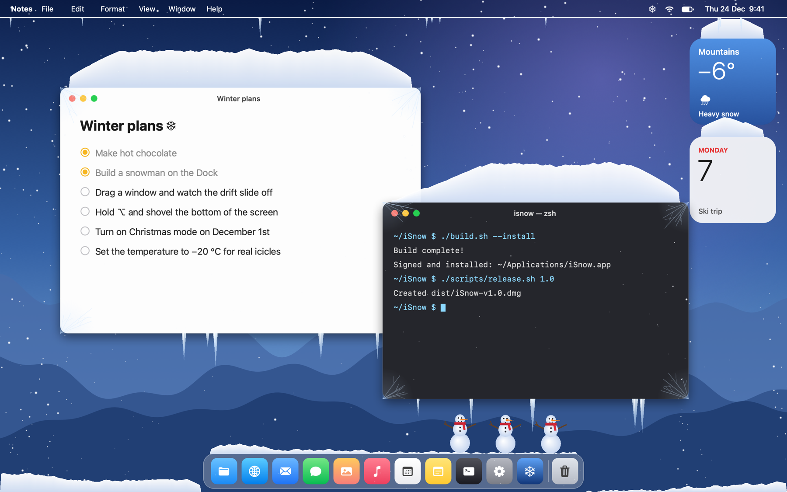

**Current version: 1.1** · macOS 14 Sonoma or later · Apple silicon and Intel · about 1 MB · [MIT License](LICENSE)

## Install

### Download (recommended)

1. Download **`iSnow-v1.1.dmg`** (and `iSnow-v1.1.dmg.sha256`) from the
   [Releases](https://github.com/filiphajduch420/iSnow/releases/latest) page.
2. Verify the download – with both files in the same folder, run:
   ```sh
   shasum -a 256 -c iSnow-v1.1.dmg.sha256
   ```
   It should print `iSnow-v1.1.dmg: OK`. The SHA-256 of `iSnow-v1.1.dmg` is:
   <!-- sha256 -->
   ```
   461f28d5124d3ef12fe9efa18da482b8ad8e5618cc2e1f52123063548a01f9b5
   ```
   <!-- /sha256 -->
3. Open the DMG and drag **iSnow** onto **Applications**.
4. Open iSnow. Because it isn't signed with an Apple Developer ID certificate, macOS says it can't
   verify the app. Go to **System Settings → Privacy & Security**, scroll down, click
   **Open Anyway** next to the iSnow message and confirm with **Open**. (Or run
   `xattr -dr com.apple.quarantine /Applications/iSnow.app` in Terminal.) The app is fully open
   source – you can read every line and build it yourself.
5. A snowflake appears in the menu bar and it starts snowing. For snow on the Dock and desktop
   icons, [allow Accessibility](#allowing-accessibility).

**Updating:** quit iSnow and drag the new version onto **Applications**, replacing the old one.
macOS treats every new download as a different app, so the Accessibility switch can still look on
but no longer work (the menu then says *Dock position is estimated*). Once per update, open
**System Settings → Privacy & Security → Accessibility**, select **iSnow**, remove it with **−** and
add it again with **+**.

### Build from source

All you need is Xcode or just the Xcode Command Line Tools (`xcode-select --install`, Swift 6) –
there are no other dependencies.

```sh
git clone https://github.com/filiphajduch420/iSnow.git
cd iSnow
./build.sh --install          # builds and signs iSnow.app, copies it to ~/Applications and launches it
```

| Command | What it does |
|---|---|
| `./build.sh` | Builds `build/iSnow.app` (universal). Signs it with your *Apple Development* certificate if you have one, so Accessibility survives rebuilds; otherwise ad hoc. |
| `./build.sh --install` | The same, then installs it to `~/Applications` and launches it. |
| `./scripts/release.sh 1.1` | Builds the release DMG and its SHA-256 checksum into `dist/` and updates the version and checksum in this README. |
| `./scripts/screenshots.sh` | Renders the screenshots and the snowplow animation below into `media/` – no screen recording needed. |

With full Xcode both architectures are built in one go. With only the Command Line Tools the scripts
build Apple silicon and Intel separately and join them with `lipo` (set `ISNOW_SEPARATE_ARCHS=1` to
force that path).

## Screenshots

| | |
|---|---|
| 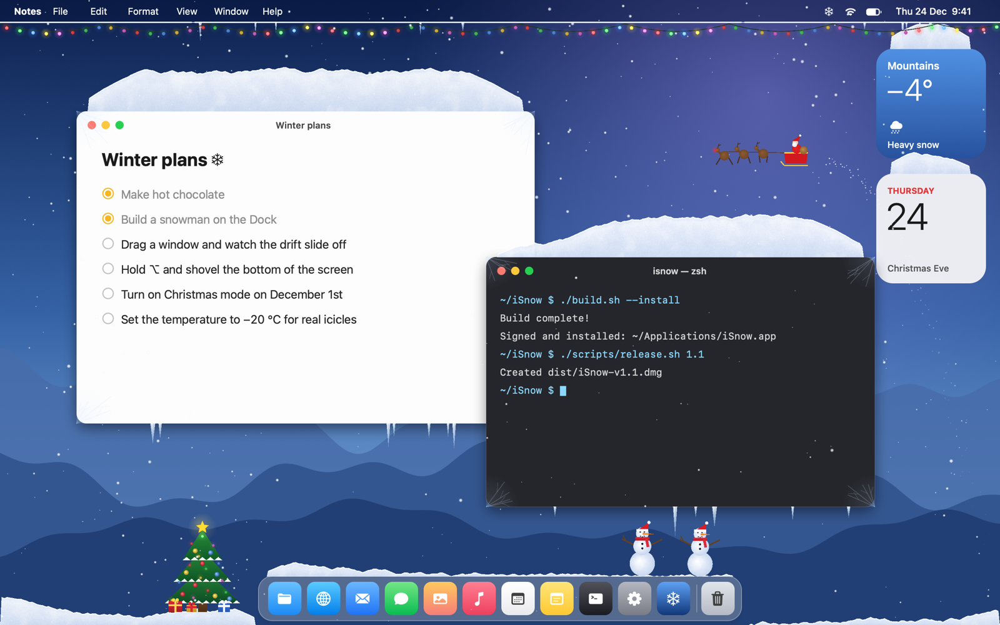 | 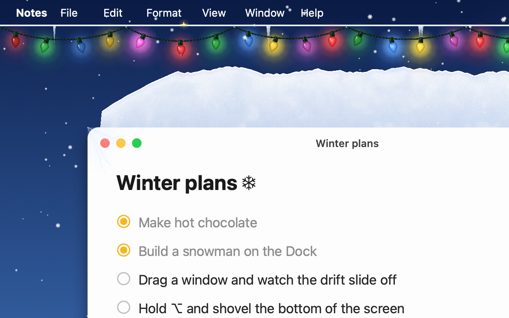 |
| **Christmas mode** – a tree, lights under the menu bar, Santa hats and Santa's sleigh | **Christmas lights** – pick the style, the bulb size and how brightly they glow |
| 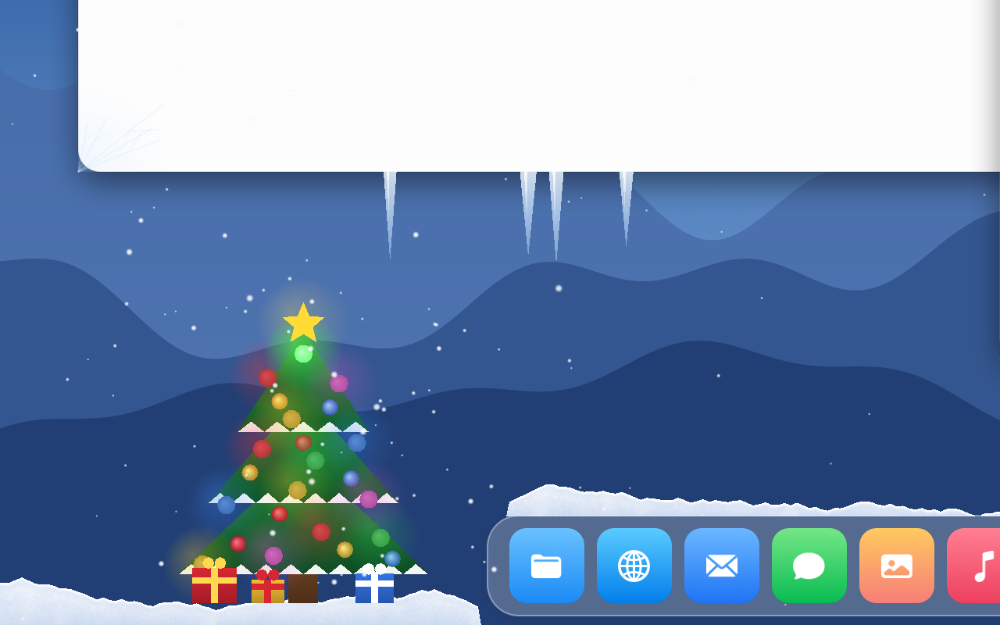 | 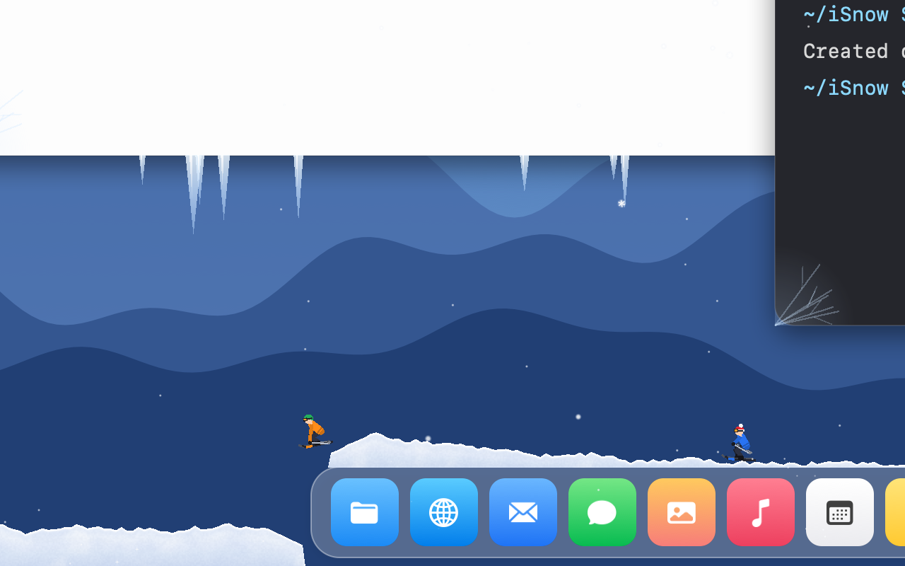 |
| **The tree** – twinkling lights, a glowing star and presents next to the Dock | **Skiers** – they ride along the bottom, across the Dock and jump off the end |
| 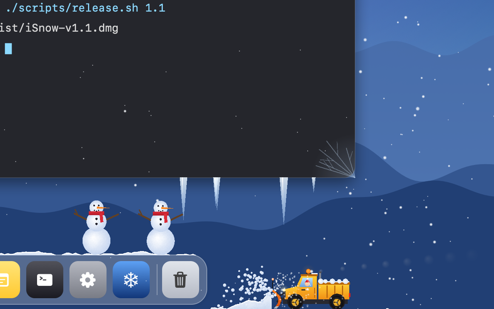 | 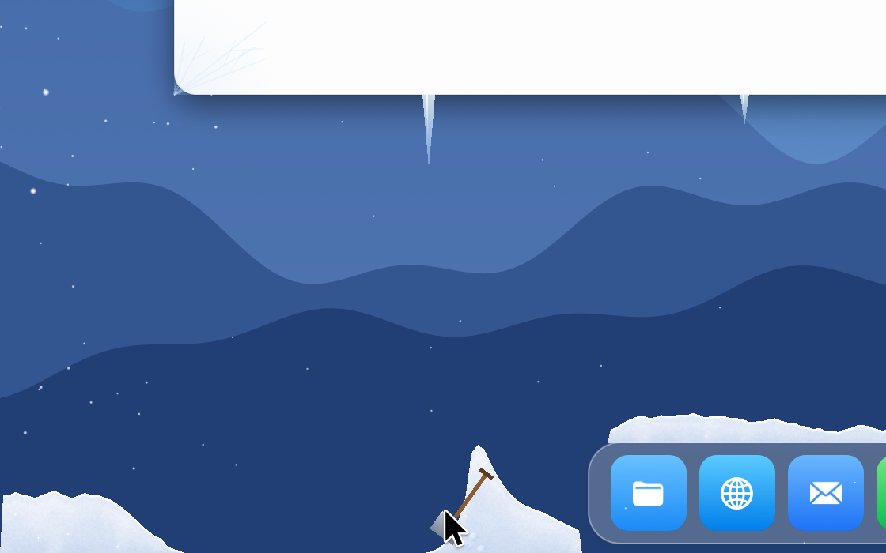 |
| **Snowplow** – pushes the snow into a ridge and throws the rest aside | **Shovel** – hold ⌥ Option and push the snow out of the way |
| 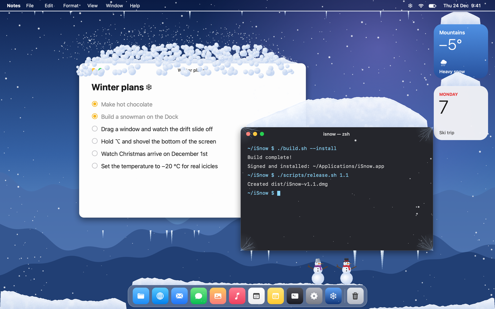 | 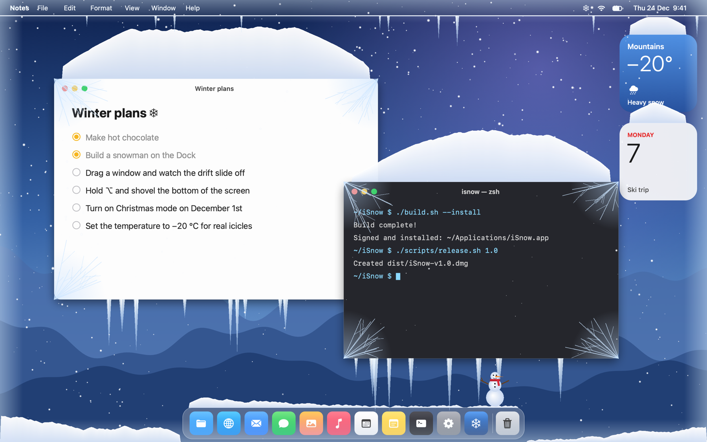 |
| **Move a window** – the drift breaks off and crumbles into clumps | **Hard frost (−20 °C)** – long icicles and frosted windows |

## Features

- **Snowfall** with parallax depth, gusty wind and four presets: Flurry, Normal, Blizzard and
  Snowstorm. Over the window you're working in, the flakes calm down to a light dusting (optional).
- **Drifts** pile up on the visible top edges of windows, on the Dock, desktop icons and widgets,
  and along the bottom of the screen. Hidden parts of a window stay free of snow, and snow never
  grows into a window in front of it. By default drifts keep growing into hills; you can set a
  maximum height instead.
- **Move a window** and its drift breaks off as a slab that crumbles into clumps with a puff of
  powder, carried a little in the direction you dragged it. The clumps land on whatever is below and
  pile up again. A small nudge only shakes off the loose top layer. Close a window and all of its
  snow falls. Switching Spaces keeps the snow on your windows.
- **Shovel:** hold **⌥ Option** for a moment and a shovel appears at the cursor. It pushes the snow
  it touches out of the way – on windows, on the Dock and at the bottom of the screen. A quick swipe
  of the cursor without ⌥ only brushes a little snow off the top – the shovel bites much deeper. (macOS doesn't let a background app replace the system cursor,
  so the shovel is drawn next to it.) The menu also has *Shovel Snow at the Bottom*.
- **Snowplow:** when the snow at the bottom of the screen or on the Dock gets deep – 60 pt by
  default, adjustable from 10 to 150 pt – a little snowplow truck, flashing beacon and all, drives across the whole
  screen and over the Dock. Its blade pushes the snow into a ridge ahead and throws the rest aside
  as spray, leaving a clear road behind. *Send the Snowplow Now* calls it right away.

  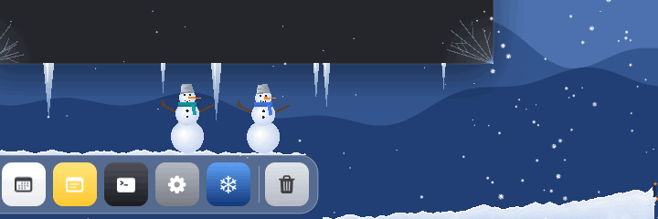

- **Skiers:** every couple of minutes (adjustable from 30 seconds to an hour) a group of little skiers (three by default, up to five) comes
  in at one edge of the screen, skates along the snow at the bottom, jumps up onto the Dock, rides
  across it and jumps off the other end – sometimes with a flip, a spin or a grab – and skis off
  the screen, leaving a faint track. *Send Skiers Now* sends a group right away.
- **Icicles** grow under windows that stay still for a while (and under the menu bar). Move the
  window and they snap off.
- **Snowmen** on the Dock (one to six): each one rolls three balls, stacks them, puts on a scarf
  and a carrot nose, waves and throws snowballs at your windows and icons. Their eyes follow your
  cursor. After a few minutes a snowman falls apart and melts, and later a new one appears. Click a
  snowman to knock it apart – every third hit knocks off a level, and sometimes it fights back.
- **Drag a snowman** anywhere – onto a window, next to the Dock, wherever you like. It drops onto
  whatever is below, and if that window moves, it falls again.
- **Temperature** from −25 °C to +10 °C (or °F). Below zero nothing melts: icicles grow faster,
  longer (up to about 3× in hard frost) and thicker, and windows frost over from the corners – the
  colder, the more. Above zero the snow gets wet and melts quickly, icicles melt and snowmen shrink;
  above +4 °C it turns to sleet and nothing settles.
- **Stays out of your way:** snow at the bottom never covers the Dock's icons and hides behind
  windows, icicles never hang into the Dock, snowmen and the tree hide under menus and popovers, and
  a snowman that covers a window fades out and lets clicks through. Without Accessibility permission
  the Dock's position is estimated.
- **Full-screen apps** (also on Macs with a notch and in Split View) get only a faded snowfall –
  30 % by default, adjustable down to none – and the icicles at the top. Drifts, snowmen and the
  tree hide and come back exactly as they were when you leave full screen or switch Spaces.

  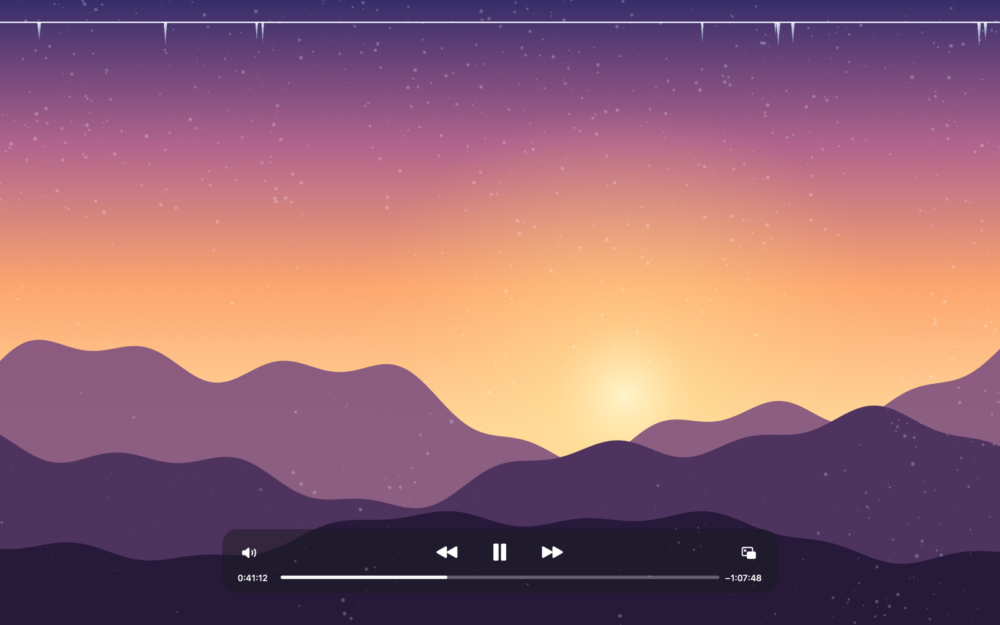

- **Christmas mode:** a decorated tree with twinkling lights, a glowing star and presents next to
  the Dock, a string of lights under the menu bar (colorful, warm white or chasing, with adjustable
  bulb size and brightness), Santa hats for the snowmen, and Santa's sleigh flying across the screen
  now and then (or right away with *Send Santa Now*).
- **Extras:** the cursor scatters flakes, sparkling flakes, a custom snow color, frosted screen
  edges, and an option to keep the snow out of screenshots and screen sharing.

### Hide Effects and battery saver

- **Hide Effects** in the menu makes everything disappear for 15 minutes, 1 hour, until tomorrow or
  until you turn it back on – without quitting. The drifts come back exactly as they were.
- **Battery saver** (on by default): on battery, iSnow runs at 30 fps and standard resolution, with
  fewer flakes and no sparkle. You can turn it off on the *Other* tab.

## Settings

Open **Settings…** (⌘,) from the snowflake in the menu bar. If the snowflake is hidden behind the
notch, open iSnow again from Finder or Spotlight and the Settings window comes up.

| Tab | What you can change |
|---|---|
| Snowfall | Preset, density, maximum number of flakes, temperature, flake size, fall speed, wind, sparkle, calm snow over the active window, snow color |
| Drifts | Where snow settles (windows, Dock, desktop icons, widgets, menu bar), unlimited hills or a maximum drift height on windows and at the bottom, pile-up speed, *Shake Off All Snow*, window frost, icicles and their length |
| Snowman | On/off, number of snowmen, size, break between snowmen, fading when covering a window, *Back to the Dock*, *Build Now*, snowball fight and how often they throw, skiers – how often and how many at once, *Send Skiers Now* |
| Christmas | Christmas mode, the tree and its size, lights under the menu bar, Santa hats, light style, size and brightness, lights while the snow is paused, Santa's sleigh, *Send Santa Now* |
| Other | Cursor interaction, the snowplow and the snow height it comes at, *Send the Snowplow Now*, frosted screen edges, snow over full-screen apps (opacity), 30 / 60 / 120 fps, sharp Retina rendering, battery saver, launch at login, Fahrenheit, hiding from screenshots and screen sharing, *Restore Defaults* |

| | | |
|---|---|---|
| 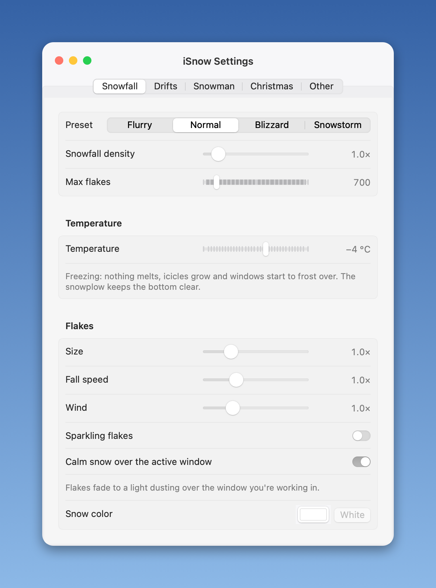 | 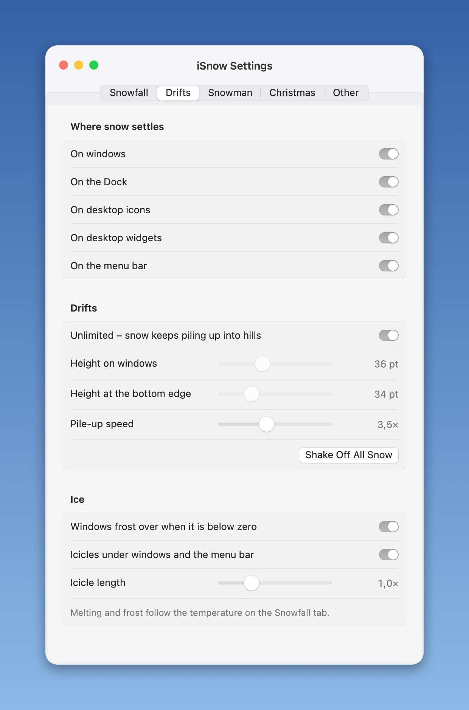 | 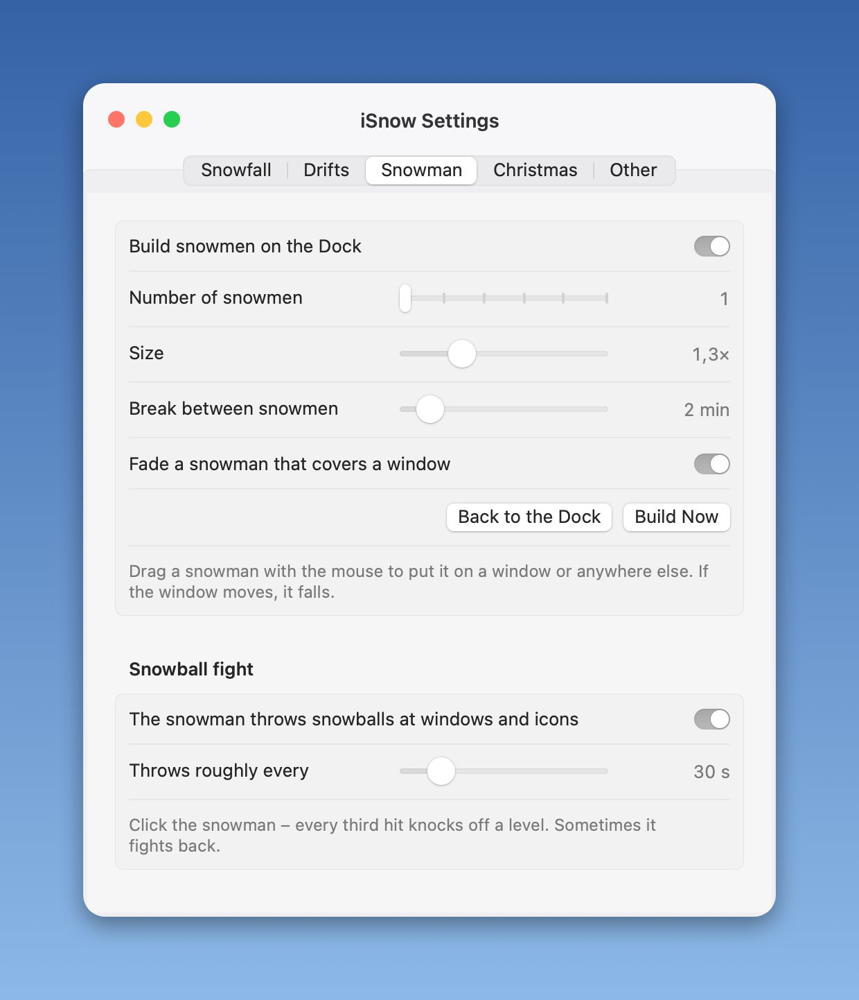 |
| **Snowfall** | **Drifts** | **Snowman** |
| 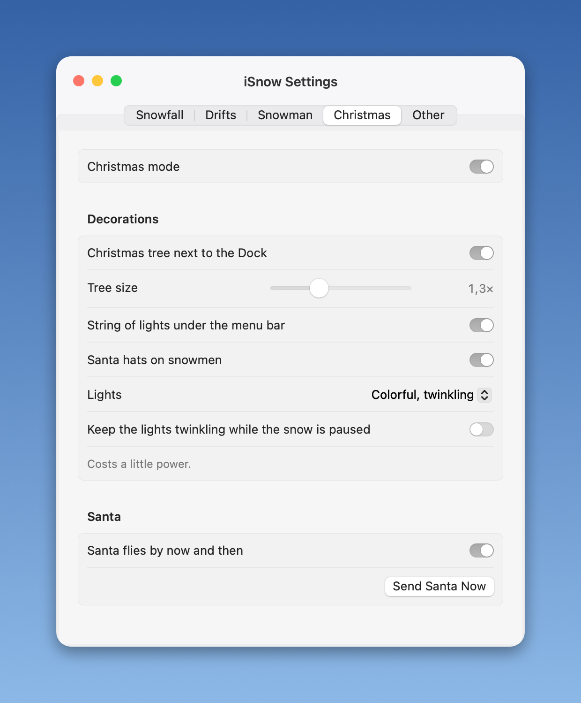 | 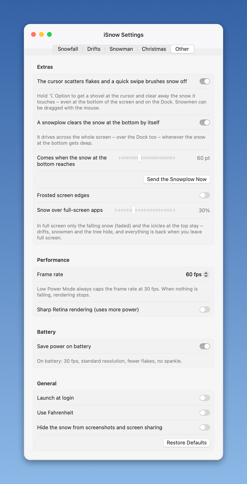 | |
| **Christmas** | **Other** | |

The app is in English and Czech and follows your system language.

## Permissions and privacy

- **No permission is needed for snow on windows and desktop widgets.** Their positions come from
  `CGWindowList`. iSnow uses only window positions and sizes – no window titles, no content. No
  Screen Recording permission is used.
- **The exact position of the Dock and snow on desktop icons** need *Accessibility* permission (to
  read the positions of the Dock and the desktop icons). Without it, everything else still works
  and the Dock's width is estimated from the apps pinned to it (read from the Dock's preferences) –
  usually close, but it can be off by an icon or two.
- The snow shows up in screenshots and screen sharing unless you turn on *Hide the snow from
  screenshots and screen sharing* (Settings → Other).
- No network access, no analytics, nothing leaves your Mac. Settings are stored in `UserDefaults`.

### Allowing Accessibility

1. Click the snowflake in the menu bar and choose **Allow Snow on the Dock and Icons…**
   (or open **Settings… → Drifts → Allow…**). macOS shows a prompt – click **Open System Settings**.
2. If the prompt doesn't appear, open **System Settings → Privacy & Security → Accessibility** yourself.
3. Turn on the switch next to **iSnow**. If iSnow isn't listed, click **+** at the bottom of the list,
   choose **iSnow** in your **Applications** folder (`~/Applications` if you used `./build.sh --install`)
   and click **Open**.
4. Confirm with Touch ID or your password. Within a second the snowmen line up along the whole Dock
   and snow starts settling on your desktop icons – no restart needed.

**After an update or a rebuild** the switch can stay on but stop working, because an app without a
Developer ID signature looks like a new app to macOS. Select **iSnow** in the list, remove it with
**−** and add it again (step 3). `build.sh` avoids this for your own builds by signing with your
*Apple Development* certificate if you have one (any free Apple ID signed in to Xcode gives you one).

The menu shows *Dock position is estimated* while iSnow doesn't have the permission.

## Performance

iSnow is built to stay out of the way:

- one instanced Metal draw call for all particles and one for all triangles (drifts, icicles,
  snowmen); shaders are compiled from source, so there are no textures or other assets;
- rendered at standard (1×) resolution by default – a quarter of the pixels of a 2× Retina frame
  for the GPU and the window compositor; *Sharp Retina rendering* is optional;
- `CADisplayLink` capped at 60 fps (configurable), 30 fps in Low Power Mode and on battery; faded snow
  over full-screen apps is drawn at 30 fps, and an optional power-saving mode does the same for calm
  snowfall, switching to the full rate only while something fast is on screen;
- rendering stops completely when nothing is moving, while the snow is paused or hidden, over
  full-screen apps when their snow is set to none, and while the screen is asleep or locked – no
  timer runs then either;
- window positions are polled 2.5–5× per second (10× while a mouse button is down, 30× while a
  window is being dragged), and Accessibility queries run off the main thread every 1–3 seconds
  (not at all while a full-screen app covers the screen).

<!-- perf -->
Measured on a 14" MacBook Pro (M1 Pro) on AC power with maxed-out settings (6,000 large flakes,
Christmas mode, 60 fps): about 10 % of one CPU core and about 40 MB of memory (version 1.1 used
88 MB). With the optional power-saving mode (Settings › Other), which draws calm snowfall at 30 fps
and switches to the full rate only while something fast moves, it drops to about 4–5 %. The
simulation itself takes well under a tenth of a millisecond per frame; most of the cost is the
system compositing a full-screen layer. The app bundle is about 1 MB.
<!-- /perf -->

### Known limitations

- **Mission Control and Stage Manager:** while Mission Control is open (or windows move into the
  Stage Manager strip), drifts and icicles can float where the windows were before. They line up
  again when you close it.

## How it works

| File | Role |
|---|---|
| `App.swift` | SwiftUI `MenuBarExtra`, the settings scene and the app delegate that wires up screens, polling and power events |
| `SettingsView.swift` | The settings window |
| `Settings.swift` | `@Observable` settings, presets, JSON persistence, launch at login (`SMAppService`) |
| `AppState.swift` | Runtime state shown in the menu: hidden effects, battery saver, full-screen pause |
| `Tracker.swift` | Window positions (`CGWindowList`), the Dock and desktop icons (Accessibility) |
| `Simulation.swift` | Per-screen simulation: flakes, drift height maps, falling chunks, icicles, snowballs, the cursor and the shovel, Santa, and when the skiers and the snowplow come |
| `Snowman.swift` | The snowman's state machine and drawing |
| `Skier.swift` | The skiers: riding along the bottom and across the Dock, jumps, tricks, tracks and drawing |
| `Snowplow.swift` | The snowplow: driving across the bottom and over the Dock, the blade's ridge and spray, and drawing |
| `Christmas.swift` | The tree, presents, the string of lights and Santa's sleigh |
| `Mesh.swift` | Triangle helpers |
| `Renderer.swift` | Metal renderer with a triple-buffered ring of vertex buffers |
| `Overlay.swift` | Click-through overlay window per screen, display link, the snowman's click panel |
| `Snapshot.swift` | Debug mode that renders a fake scene to a PNG |
| `Promo.swift` | Renders the README screenshots and the snowplow GIF – a drawn desktop with the real simulation on top – and every settings tab |

Each drift is a height map with 4-point bins along the top edge of a surface. Flakes that cross the
surface deposit snow into a bin, and a simple slope rule spreads it to the neighbors, so drifts
round off at the ends. When a window moves or disappears, its height map turns into falling chunks
that can land on surfaces further down.

### Debug snapshot

```sh
swift build -c release
.build/release/iSnow --snapshot /tmp/isnow.png
```

This simulates a scene with fake windows, a Dock and icons and saves it as an image – handy for
checking the rendering without screen recording permission. Environment variables change the scene:

| Variable | Effect |
|---|---|
| `ISNOW_TEMP=3` | Temperature in °C (default −15) |
| `ISNOW_SNOWMEN=2` | Number of snowmen |
| `ISNOW_SECONDS=600` | Simulates ten minutes of snowfall first (default 75 s) |
| `ISNOW_MAX=1` | A single zoomed window instead of two |
| `ISNOW_DRAG=14` | Drags a window for 14 frames and captures the snow falling off |
| `ISNOW_WIDGETS=1` | Adds a desktop widget (`=0`: one that snow falls through) |
| `ISNOW_XMAS=0` | Christmas mode with light style 0, 1 or 2 (colorful, warm white, chasing) |
| `ISNOW_LIGHTSIZE=2` | Size of the Christmas light bulbs |
| `ISNOW_GLOW=1.5` | How brightly the Christmas lights glow |
| `ISNOW_SANTA=1` | Sends Santa's sleigh just before the picture is taken |
| `ISNOW_SKIER=1.5` | Sends a group of skiers 1.5 s before the picture |
| `ISNOW_NOTCHFULL=1` | After a minute, a full-screen app below the notch with the menu bar hidden |

## Contributing

Issues and pull requests are welcome. Please keep the app lightweight: no third-party
dependencies, no extra assets, and nothing that runs when nothing is moving.

## License

[MIT](LICENSE) © 2026 Filip Hajduch
